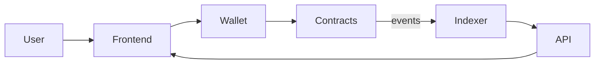
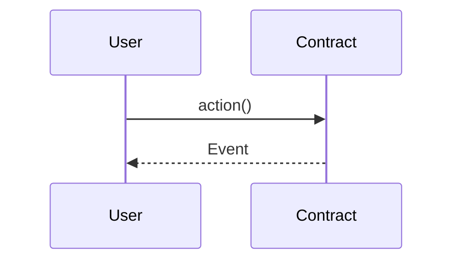
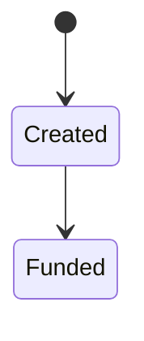

# Design Templates

Copy these into `systems/NN-name/` for each system. Keep each document short and specific; every section should contain numbers or concrete decisions, not generalities.

---

## 1. Requirements (`01-requirements.md`)

```markdown
# <System name>: Requirements

## Problem and context
<2-4 sentences: who has the problem, why it matters>

## Do we need a blockchain?
| Question | Answer |
|---|---|
| Multiple parties write shared state? | |
| Do they distrust each other / no acceptable trusted intermediary? | |
| Need public verifiability or censorship resistance? | |
| Need programmable custody/settlement of assets? | |
Conclusion: <blockchain / database / hybrid, and why>

## Actors
| Actor | Goals | Trust level |
|---|---|---|

## Functional requirements
- FR-1 As a <actor>, I can <action> so that <outcome>.
  - Acceptance: <testable criteria>

## Non-functional requirements
| ID | Category | Requirement (with numbers) |
|---|---|---|
| NFR-1 | Throughput | e.g. 50 tx/s peak |
| NFR-2 | Finality | e.g. user sees confirmation < 5 s, economic finality < 15 min |
| NFR-3 | Cost | e.g. < $0.05 per user action |
| NFR-4 | Availability | |
| NFR-5 | Privacy/compliance | |
| NFR-6 | Upgradeability | |

## Trust assumptions and threat model
| Role | Trusted for | Worst case if malicious/compromised | Mitigation |
|---|---|---|---|

## Out of scope
```

---

## 2. High-level design (`02-hld.md`)

```markdown
# <System name>: High-Level Design

## Platform selection
| Criterion (weight) | Option A | Option B | Option C |
|---|---|---|---|
| Cost per tx (x) | | | |
| Finality/latency (x) | | | |
| Security/decentralization (x) | | | |
| Ecosystem/tooling (x) | | | |
| Compliance fit (x) | | | |
| Weighted score | | | |
Decision: <option> (see ADR-001)

## Architecture overview


## On-chain vs off-chain
| Data / logic | Where | Why |
|---|---|---|

## Components
| Component | Responsibility | Tech | Owner of keys/permissions |
|---|---|---|---|

## Key flows


## Cross-cutting concerns
- Key management and custody:
- Admin powers, governance, timelocks:
- Upgrade strategy:
- Oracles and external dependencies (and their failure modes):
- Observability and alerting:
- Incident response (pause, upgrade, comms):
- Compliance and data privacy:

## Risks and open questions
```

---

## 3. Low-level design (`03-lld.md`)

```markdown
# <System name>: Low-Level Design

## Contract: <Name>
**Responsibility:** <one sentence>
**Upgradeability:** immutable / UUPS / transparent / diamond (ADR-00x)

### State machine


### Storage layout
| Slot/var | Type | Purpose | Packing notes |
|---|---|---|---|

### Interface
| Function | Visibility | Access | Pre-conditions | Effects | Events | Errors |
|---|---|---|---|---|---|---|

### Roles and access control
| Role | Holder | Powers | Constraints (timelock, multisig) |
|---|---|---|---|

### Invariants (become invariant tests)
- INV-1: <e.g. sum of balances == token.balanceOf(this)>

### Security considerations
- Reentrancy:
- Oracle/price manipulation:
- Signature replay (EIP-712 domain, nonces, chainId):
- Front-running / MEV:
- DoS (unbounded loops, griefing):
- Rounding/precision:

### Gas notes

## Off-chain service: <Name>
- Inputs/outputs, data schema
- Reorg handling (confirmations depth, rollback strategy)
- Idempotency, retries, nonce management
- Key handling (KMS/HSM/MPC)
- Scaling and failure modes

## Test plan
| Type | Scope | Tool |
|---|---|---|
| Unit | | Foundry |
| Fuzz | | Foundry |
| Invariant | | Foundry |
| Fork | | Foundry + mainnet RPC |
| Integration (off-chain) | | |
```

---

## 4. Architecture Decision Record (`adr/ADR-NNN-title.md`)

```markdown
# ADR-NNN: <Decision title>
Status: Proposed | Accepted | Superseded by ADR-xxx
Date:

## Context
<the forces at play, constraints, requirements referenced (FR/NFR ids)>

## Options considered
1. <Option> - pros / cons
2. <Option> - pros / cons
3. <Option> - pros / cons

## Decision
<what we chose>

## Consequences
<what becomes easier, what becomes harder, what we must monitor, when to revisit>
```

---

## 5. Security self-audit checklist (`05-security.md`)

- [ ] Access control on every state-changing function; roles minimal
- [ ] Checks-effects-interactions; `nonReentrant` where external calls exist
- [ ] Token transfers via `SafeERC20`; fee-on-transfer/rebasing tokens considered
- [ ] Oracle staleness, deviation, and manipulation checks
- [ ] Signatures: EIP-712, nonce, deadline, chainId, `ecrecover` zero-address check
- [ ] No unbounded loops over user-controlled arrays
- [ ] Rounding direction favors the protocol
- [ ] Upgrade: storage layout checked, initializer protected, `_disableInitializers()` in constructor
- [ ] Pause/circuit breaker and who can trigger it
- [ ] Events for every state change that off-chain systems need
- [ ] Slither/Aderyn run, findings triaged
- [ ] Invariant tests cover every INV-x from the LLD

## Findings
| ID | Severity | Description | Status |
|---|---|---|---|
```

---

## 6. Learner profile (`LEARNER_PROFILE.md`)

```markdown
# Learner Profile
- Background:
- Current level (L1-L5) and evidence:
- Target role and timeline:
- Domain interests:
- Preferred chains/stack:
- Weekly time:

## Progress
| Module | Phase reached | Mastered | Needs work | Date |
|---|---|---|---|---|

## Known weak spots

## Next session
```
